# APIX

Published as apix-hedera from 2.1.1 (earlier versions: apix-ai).

**A CLI that adds working Hedera integrations to a Next.js app.**
Hedera Africa Hackathon 2025, Developer Tools & Infrastructure track.

APIX analyses your project and writes Hedera Token Service, Consensus
Service, smart contract and wallet code into it: server-side modules, API
routes, React hooks and components that build and run as generated. The
code signs with your operator account on the server, and the private key
never reaches the browser. Optional AI commands (Anthropic or OpenAI)
explain Hedera concepts and help you choose an integration.

**Status: v2.1, testnet-proven.** Every Hedera operation below was run on
testnet and verified on the mirror node. The IDs, links and fees are in
[docs/TESTNET_PROOF.md](docs/TESTNET_PROOF.md).

What changed in 2.1 and why: [docs/REVIVAL_2.1.md](docs/REVIVAL_2.1.md).

Repository: [github.com/tdeu/apix](https://github.com/tdeu/apix)

## Support matrix

| Project | `apix add` |
|---|---|
| Next.js, App Router, TypeScript | Supported: `hts`, `consensus`, `smart-contract`, `wallet` (HashPack and Blade, via their browser extensions) |
| React/Vite, TypeScript | `wallet` only, experimental |
| Anything else (Pages Router routes, JavaScript, Vue, Angular, Express, plain Node) | Refused with a message; the project is left unchanged |

The Pages Router is supported for `wallet` and `smart-contract`, which
generate no routes. Tested with Next.js 16.3.6.

## Quick start

The measured part (the app's install, then `apix add hts` through
`next build`) took about 6 minutes on a laptop; installing APIX from source
adds its own `npm ci`. You need Node.js 20+, git, and a free Hedera
testnet account from [portal.hedera.com](https://portal.hedera.com/faucet)
(its account ID and DER-encoded private key).

1. Install APIX:

   ```bash
   npm install -g apix-hedera
   ```

2. Create a Next.js app and add HTS:

   ```bash
   npx create-next-app@latest my-hedera-app --ts --app --src-dir --eslint --tailwind --import-alias "@/*" --use-npm --yes
   cd my-hedera-app
   apix add hts
   ```

3. Put your testnet account in `.env.local` (server-side only; never
   `NEXT_PUBLIC_`):

   ```bash
   HEDERA_NETWORK=testnet
   HEDERA_ACCOUNT_ID=0.0.xxxxx
   HEDERA_PRIVATE_KEY=302e...
   ```

4. Build and start it (or use `npx next dev`):

   ```bash
   npx next build
   npx next start
   ```

5. Call the four generated routes. Replace `0.0.TOKEN` with the ID from the
   first response, and `0.0.RECIPIENT` with an account that can receive the
   token:

   ```bash
   curl -X POST http://localhost:3000/api/tokens/create -H "content-type: application/json" -d '{"name":"My Token","symbol":"MYT","decimals":2,"initialSupply":100000}'
   curl "http://localhost:3000/api/tokens/info?tokenId=0.0.TOKEN"
   curl -X POST http://localhost:3000/api/tokens/mint -H "content-type: application/json" -d '{"tokenId":"0.0.TOKEN","amount":5000}'
   curl -X POST http://localhost:3000/api/tokens/transfer -H "content-type: application/json" -d '{"tokenId":"0.0.TOKEN","toAccountId":"0.0.RECIPIENT","amount":1000}'
   ```

The full walk-through is in [docs/getting-started.md](docs/getting-started.md).

### Measured timings

From one run in Phase 4 of the revival, on a Windows 10 laptop with about
1.3 GB of free RAM
([details](docs/TESTNET_PROOF.md#timings-phase-4-one-run-windows-10-laptop-about-12-to-14-gb-free-ram)):

- the fresh app's own `npm install`: 107.7 s;
- from the start of `apix add hts` to a successful `next build`: 246.6 s
  (about 4 minutes). This includes `add hts` installing its packages
  (94.6 s), `apix add consensus` (14.2 s) and `next build` (107.5 s).

## Commands

Full reference: [docs/commands.md](docs/commands.md).

**No keys needed:** `apix analyze`, `apix add <integration>`, `apix init`,
`apix status`, `apix health`, `apix logs`, `apix last-error`,
`apix debug-info`, `apix --help`, `apix --version`.

**Needs Hedera credentials** (`HEDERA_ACCOUNT_ID`, `HEDERA_PRIVATE_KEY`):
`apix validate` (a local check, no network call), `apix create-token`, and
`apix add hts --create-token`. The last two submit transactions and cost
HBAR.

**Needs an AI key** (`ANTHROPIC_API_KEY` or `OPENAI_API_KEY`):
`apix explain`, `apix compare`, `apix recommend`, `apix confidence`,
`apix debug`, `apix generate`, `apix chat`. Without a key they exit 1 with a
message saying which key to set.

**Experimental:** `apix compose --experimental`. It is hidden from `--help`
unless `APIX_EXPERIMENTAL=1` is set, needs an AI key, and lists the files it
composed (with any unimplemented stubs) without writing them.

## Hedera integration summary

What each `apix add` generates is in
[docs/integrations.md](docs/integrations.md). Every ID below is from the
testnet proof and links to HashScan.

### Hedera Token Service (HTS)

Tokens are the most common first step on Hedera. HTS creates them natively,
without deploying a contract, so the generated code is a thin, auditable
layer over the SDK.

- **Transactions:** TokenCreateTransaction, TokenMintTransaction,
  TransferTransaction, TokenInfoQuery. Token association is not part of 2.1
  (see [integrations](docs/integrations.md#hts)).
- **Proven on testnet:**
  - token [0.0.10782448](https://hashscan.io/testnet/token/0.0.10782448):
    created, minted and transferred through APIX's library;
  - token [0.0.10782464](https://hashscan.io/testnet/token/0.0.10782464):
    created by `apix create-token` with admin and supply keys;
  - token [0.0.10782086](https://hashscan.io/testnet/token/0.0.10782086):
    created, minted and transferred through a generated app's routes;
  - token [0.0.10782603](https://hashscan.io/testnet/token/0.0.10782603):
    created by a generated app without `maxSupply` (infinite supply).
- **Observed fees (testnet):** token create 12.94 ℏ, mint 0.013 ℏ, and a
  first transfer to an auto-associating account 0.65 ℏ.

### Hedera Consensus Service (HCS)

HCS gives an ordered, timestamped log without running a contract. That
makes it a simple way for an app to record events.

- **Transactions:** TopicCreateTransaction, TopicMessageSubmitTransaction.
- **Proven on testnet:**
  - topic [0.0.10782451](https://hashscan.io/testnet/topic/0.0.10782451)
    with two messages (library);
  - topic [0.0.10782081](https://hashscan.io/testnet/topic/0.0.10782081)
    (generated `/api/consensus/*` routes).
- **Observed fees (testnet):** topic create 0.13 ℏ, message submit
  0.002 ℏ.

### Smart contracts

For logic that HTS and HCS don't cover, the generated module deploys
Solidity bytecode and calls it with ABI-encoded arguments.

- **Transactions:** ContractCreateFlow (FileCreateTransaction,
  ContractCreateTransaction, FileDeleteTransaction),
  ContractExecuteTransaction, ContractCallQuery.
- **Proven on testnet:**
  - contract [0.0.10782455](https://hashscan.io/testnet/contract/0.0.10782455)
    (library);
  - contract [0.0.10782597](https://hashscan.io/testnet/contract/0.0.10782597)
    (generated `smartContractManager`).
  In both, `set(...)` wrote a string and `get()` read the same string back.
- **Observed fees (testnet):** deploy 14.80 ℏ in total (1.64 + 13.07 +
  0.09 ℏ), `set` call 0.05 ℏ.

### Accounts and fees

- Operator account: `0.0.10780747` (ECDSA). Demo recipient: `0.0.10777128`
  (ED25519, unlimited automatic associations).
- The whole library proof (token create, mint and transfer, topic with two
  messages, contract deploy and call) cost 28.59 ℏ of testnet HBAR, which
  the testnet faucet provides for free.
- Hedera fees are fixed in USD, so costs are predictable when planning an
  app. The HBAR amounts above vary with the HBAR price and with each
  transaction's options (see the
  [fees table](docs/TESTNET_PROOF.md#fees-observed)).

## Architecture

```mermaid
flowchart LR
  dev[Developer] -->|apix add hts| cli[APIX CLI]
  subgraph APIX
    cli --> analyzer[Project analyzer<br/>framework, layout]
    analyzer --> policy[Support policy]
    policy --> planner[Integration planner]
    planner --> templates[Handlebars templates]
    templates --> generator[Generator<br/>overwrite check, rollback]
  end
  generator -->|writes files, npm install| app
  subgraph app[Generated Next.js app]
    ui[React UI<br/>hooks, components] -->|HTTP| routes[API routes<br/>server-only]
    routes --> sdk[Hedera SDK client<br/>operator key]
  end
  sdk -->|signed transactions| hedera[(Hedera network<br/>HTS, HCS, contracts)]
  hedera -->|receipts: IDs, status| sdk
  hedera -->|records| mirror[(Mirror node / HashScan)]
  mirror -->|verification| dev
```



`apix create-token` and `apix validate` use APIX's own SDK layer
(`src/services/hedera-operations.ts`) directly, without generating code.

## Security

- **Keys stay on the server.** The generated Hedera modules start with
  `import 'server-only'`, so importing them from client code fails the
  build. Credentials are read from server environment variables; the
  generated code never uses `NEXT_PUBLIC_` for them.
- **No fallbacks.** Missing credentials or AI keys are errors with a clear
  message. APIX never uses mock data, test accounts or canned AI replies,
  and never reports success without an ID from the network's receipt.
- **Secrets are masked** (first 6 characters at most) in console output,
  log files, `apix logs` / `apix last-error` and error messages.
- **Mainnet needs confirmation:** with `HEDERA_NETWORK=mainnet`,
  `create-token` and `add hts --create-token` ask before spending, or need
  `--yes`.
- `.env` files are git-ignored. Start from [.env.example](.env.example).

## AI features

The AI commands use Anthropic when `ANTHROPIC_API_KEY` is set, otherwise
OpenAI when `OPENAI_API_KEY` is set. There is no silent failover between
providers; a failed request is an error with the provider's message.

| Provider | Default model | Override |
|---|---|---|
| Anthropic | `claude-sonnet-5` | `APIX_ANTHROPIC_MODEL` (`APIX_ANTHROPIC_FAST_MODEL` for the fast tier) |
| OpenAI | `gpt-4o-mini` | `APIX_OPENAI_MODEL` |

If the provider rejects a model, the error names the variable to set.

## Changes since the October 2025 hackathon submission

- Simulation mode, mock responses and test-account fallbacks were removed;
  commands fail with a clear error instead.
- The testnet IDs published in the hackathon README were never created on
  testnet. They are replaced by real, mirror-verified IDs.
- Generated code now installs, type-checks and builds in a fresh Next.js
  app, and works on testnet.
- AI commands no longer return canned replies without a key; the default
  models were updated.
- Token creation no longer goes through hedera-agent-kit (it lost token
  IDs); contract calls now encode their arguments.
- Dependencies were patched (no critical or high `npm audit` advisories in
  production dependencies).
- Commands that did nothing real (`deploy`, several `validate` flags) were
  removed.

Details: [CHANGELOG.md](CHANGELOG.md).

## Documentation

- [Getting started](docs/getting-started.md)
- [Commands](docs/commands.md)
- [Integrations](docs/integrations.md)
- [Troubleshooting](docs/troubleshooting.md)
- [Testnet proof](docs/TESTNET_PROOF.md)
- [Mainnet proof](docs/MAINNET_PROOF.md)
- [Contributing](CONTRIBUTING.md)
- [Hackathon-era documents](docs/archive/README.md) (not maintained)

## Team

- **Moustapha Diop**: Lead Developer ([@0xfishbone](https://github.com/0xfishbone))
- **Thomas De Rouck**: Blockchain Specialist ([@tdeu](https://github.com/tdeu))

## License

MIT, see [LICENSE](LICENSE).
